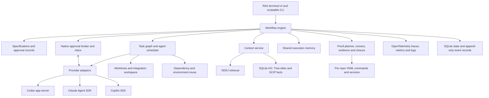

# Kode architecture and delivery plan

Status: proposed, awaiting product review. Research checked 6 November 2026.

## Product

Kode is a local-first coding CLI with a rich interactive terminal interface that coordinates existing coding harnesses across multiple repositories and ordinary folders. It follows spec-driven and proof-driven development: a user describes a feature; Kode researches the workspace, produces a cited specification and executable proof plan, obtains approval, delegates work, proves applicable acceptance criteria through integration tests or UI automation, and produces a closure report backed by evidence.

Kode owns requirements, execution state, context selection, agent assignment, approvals, and evidence of completion. Codex, Claude, and Copilot retain their own model interaction, tool execution, and conversation management.

Confirmed product requirements: multiple roots; approved specifications; proof-driven closure; custom agents; Codex, Claude, and Copilot integrations; a rich terminal interface showing agents, tool calls, context, and proof progress; simple per-repository YAML commands; open-standard observability; native Windows, macOS, and Linux support. Portability is an architectural requirement, not a late packaging task.

Terminology: Kode's "UI" means its rich interactive CLI/terminal interface (TUI). Approval prompts, agent progress, context inspection, and evidence views appear in the terminal; a separate web or desktop interface is not part of the product scope. "UI automation" in proof plans refers to testing the application being developed, which may have its own browser or desktop interface.

Initial assumptions still open for review: single developer on one machine; local execution; provider credentials supplied by the user; Git worktrees for isolated implementation; TypeScript/JavaScript and Python as the initial structural indexing languages. Other languages remain searchable with explicit graph coverage reporting.

## Research and decisions

### Provider integrations

| Provider | Recommended integration | Reason and constraint |
| --- | --- | --- |
| Codex | Local Codex app-server; bounded jobs may use SDK or `codex exec` | Supports conversation lifecycle, streamed events, interrupts, and approval requests. Implement against a tested protocol/version. [Official documentation](https://learn.chatgpt.com/docs/app-server) |
| Claude | TypeScript Claude Agent SDK | Runs the Claude Code harness and exposes sessions, skills, subagents, MCP, permissions, and hooks. SDK documentation directs third-party integrations to API-key authentication unless otherwise approved; existing consumer login cannot be assumed portable. [Official documentation](https://code.claude.com/docs/en/agent-sdk/overview) |
| Copilot | GitHub Copilot SDK | Communicates with its CLI through JSON-RPC, with session APIs, hooks, custom agents, skills, and permission callbacks. SDK and interactive CLI capabilities differ. [Official compatibility reference](https://docs.github.com/en/copilot/how-tos/copilot-sdk/troubleshooting/compatibility) |

Use supported structured interfaces instead of terminal output scraping. Provide a subprocess fallback only for capabilities whose structured output and interruption behavior have been tested. Do not promise equivalent hooks, permissions, session forks, usage reporting, or native subagent controls across providers.

Each adapter reports capabilities and tested versions. `kode doctor` checks installation, version compatibility, authentication readiness without exposing credentials, and required features. Missing required capabilities block the affected workflow with a precise reason. Optional capabilities can use a documented fallback.

### Final index and knowledge graph decision

Selected stack: **XERJ retrieval + Kode-owned SQLite graph + Tree-sitter extraction + SCIP semantic enrichment**. See [ADR-001](index-and-kg-decision.md) for the authoritative extraction, storage, snapshot, cross-repo, query, and validation contract. This settles the architecture; installation and performance checks remain implementation gates.

| Candidate | Useful capability | Proposed role |
| --- | --- | --- |
| XERJ | Local binary, AST-aware code indexing, full-text/vector/hybrid search, folder watching, HTTP and MCP interfaces; repository lists Apache-2.0 | Selected retrieval engine; Kode owns chunk extraction/publication. [Repository](https://github.com/xerj-org/xerj), [usage reference](https://xerj.org/llms.txt) |
| GitNexus | Code graph, impact analysis, call tracing, and repository groups with contract links | Not adopted; current PolyForm Noncommercial license and ownership of the graph/proof contract favor Kode's schema. [Repository](https://github.com/nxpatterns/gitnexus), [license](https://github.com/nxpatterns/gitnexus/blob/main/LICENSE) |
| Tree-sitter plus SCIP | Incremental syntax parsing, complemented by language-aware symbol definitions/references and cross-repository code intelligence | Recommended foundation for Kode's structural graph. Syntax alone cannot reliably resolve all calls. [Tree-sitter](https://tree-sitter.github.io/tree-sitter/), [SCIP indexers](https://sourcegraph.com/docs/code-navigation/writing-an-indexer) |
| Zoekt | Indexed trigram code search | Not adopted; a future replacement would require a measured need and a new decision. [Repository](https://github.com/sourcegraph/zoekt) |
| Embedded SQLite graph | Kode-owned typed node/edge tables and bounded traversal; local persistence | Selected canonical structural graph and requirement/proof traceability representation. No parallel SQLite full-text index in v1. |

Important distinction: XERJ's documented second-brain graph is a relationship layer over documents, with two-hop requests and no native shortest-path or variable-depth graph query. Its detectors include citations, file layout, and shared words. This does not establish a compiler-resolved code call graph. [Graph implementation documentation](https://github.com/xerj-org/xerj/blob/main/docs/SECOND_BRAIN.md)

Separate `RetrievalBackend` from `CodeGraphBackend`. Use XERJ for exact/lexical retrieval over Kode-published chunks and SQLite for typed structural facts and requirement/proof links. Extract with Tree-sitter and enrich with SCIP where supported. Default search combines exact symbol lookup, BM25, and bounded graph expansion. Neural embeddings are optional future work, not a prerequisite or a claim about XERJ's default lexical embeddings.

Validate the selected stack on a small repo, representative monorepo, and connected repo pair: cold indexing time, single-file update latency, RAM/disk, definition/reference accuracy, impact recall, retrieval quality, branch isolation, cross-platform packaging, and licensing/distribution suitability. Compare against direct file search. Vendor performance claims are hypotheses to test, not Kode targets already achieved.

## Architecture



Selected stack: TypeScript strict ESM on Node.js 24 LTS, npm workspaces, React/Ink rich terminal interface, Commander, Zod/YAML contracts, and SQLite via `better-sqlite3` in a worker. Use XERJ, Tree-sitter WASM, and SCIP for context; native Codex/Claude/Copilot adapters for agents; Execa/Git/Chokidar for execution and refresh; Vitest/Playwright for testing/proof; and OpenTelemetry/OTLP with structured logs. [ADR-004](tech-stack.md) is the authoritative technology, module, runtime-boundary, testing, and packaging decision. Exact versions are pinned and validated during scaffolding.

The rich CLI attaches to a local workspace runner over authenticated platform IPC (Windows named pipes or Unix-domain sockets). The runner owns native sessions and pending approvals while SQLite-backed events support terminal reconnect and recovery. This is a local CLI architecture with no required web interface or hosted backend.

Suggested modules: `cli`, `tui`, `core`, `workspace`, `context`, `memory`, `environments`, `approvals`, `specs`, `agents`, `providers/{codex,claude,copilot}`, `execution`, `proof`, and `observability`. Start these as modules with enforced interfaces; split packages only when useful.

### Workspace model

A workspace contains named roots, each with a canonical path, stable ID, type, read/write policy, Git identity when present, ignores, language coverage, and indexing status. Registering a root does not grant write access to every agent.

Handle aliases, duplicate paths, nested repositories, symlinks, Windows case normalization, moved directories, and unavailable roots. Removal unregisters the root and its derived index; it never deletes source files.

Git implementation runs use isolated task worktrees. Ordinary folders are available for research from the start; implementation there uses an explicit snapshot/patch workflow and one writer per root until equivalent recovery is established. Preserve pre-existing user edits.

Capture existing staged/unstaged and permitted untracked file contents as the run's input baseline, including deletions. Materialize that snapshot in task worktrees so agents implement against the same local state used to research the spec. Preserve source staging and user files; distinguish existing edits from agent changes. Never require a commit/stash merely to index or start a task.

Keep workspace configuration and approved feature artifacts reviewable as text. Keep transcripts, credentials, generated indexes, logs, and caches out of version control. Use platform-appropriate application-data directories, with a workspace-local ignored state option. Store XERJ's data directory outside every indexed root to avoid indexing its own storage.

### Context model

Provide a read-oriented Kode MCP facade and internal API: search, symbol context, references, dependencies, impact, contracts, and evidence retrieval. Scope every request to permitted roots and the execution snapshot. Backend-specific query languages should not leak into the main orchestration contract.

Code nodes: repository, package, module, file, symbol, endpoint, schema, and test. Workflow nodes: feature, requirement, task, change, and verification result. Edges include defines, imports, references, calls, exposes, consumes, implements, and verifies. Add cross-service links using package identities, explicit configuration, API schemas, and route evidence; names alone are insufficient.

Every fact carries provenance: root ID, file and range, content hash, revision/worktree, extractor version, and confidence/precision class. Separate compiler-resolved, syntax-derived, explicitly configured, and inferred facts. Generated architectural summaries are interpretations with citations, never authoritative code facts.

Index identity includes root, base revision, and worktree/dirty generation. Start with isolated generations and shared content-hash extraction caches; add base-plus-overlay storage only when needed while preserving deletion/replacement masking. Publish a generation only after SQLite facts and XERJ chunks are ready. File events trigger debounced updates; content hashes and reconciliation scans detect missed events, deletes, renames, and branch switches. Verify a citation against current contents before using it to edit. Stale or incomplete graphs are reported and trigger direct source inspection.

Context packs contain relevant source excerpts, contracts, impacted tests, repository instructions, evidence, and unresolved questions within a token budget. Keep canonical decisions separate from compressed conversation history.

Follow the [index/KG refresh policy](index-refresh-policy.md): refresh after local/agent file writes, commits, pulls, merges/rebases, checkout/reset/stash operations, and dependency changes. Combine filesystem watchers, provider/command events, Git-state polling, and content reconciliation. Query/task/proof/closure barriers enforce freshness; hooks are optional accelerators. Commit-only metadata changes can reuse unchanged content. Fetch/push does not require code reindexing unless local files changed. Report search/syntax and semantic freshness separately and notify agents when supplied context becomes stale.

## Spec-driven workflow

Primary progression:

`intake -> research -> spec_draft -> awaiting_approval -> approved -> planning -> implementing -> integrating -> verifying -> closed`

Runs can also enter `paused`, `blocked`, `failed`, `cancelled`, or `needs_reapproval`, with explicit allowed transitions and a recorded reason. Crash recovery attaches to an existing run rather than creating duplicate work.

1. Research relevant roots, source, tests, contracts, and repository instructions. Ask targeted questions for unresolved requirements; record assumptions separately from established behavior.
2. Produce stable requirement IDs, goals/non-goals, current behavior with citations, proposed behavior, edge cases, affected repositories, API/data changes, compatibility, migration/rollback, and measurable acceptance criteria.
3. Generate a preliminary task graph and executable proof plan so approval covers intended behavior, meaningful implementation scope, and the checks that will establish completion. Human-facing Markdown accompanies machine-readable validated metadata.
4. Record approval against the exact spec and scope hash, approver, and timestamp. Implementation cannot start without it. Editing the file cannot silently preserve approval for changed requirements.
5. Refine executable tasks within approved scope. Each task declares requirement IDs, dependencies, allowed roots/files, input/output contracts, assigned agent, verification, and resource limits. Material scope changes require a reviewed delta and reapproval.
6. Execute ready tasks. Integrate changes in dependency order into feature worktrees, then test the combined result. Cross-repository delivery is coordinated but Git commits are not atomic across repositories.
7. Map every acceptance criterion to actual verification evidence. Close only when the criteria, configured checks, review findings, and requested deliverables are resolved.

Feature artifacts: `spec.md`, `design.md`, `tasks.json`, `proof.yaml`, `approval.json`, `evidence.json`, and `closure.md`, with durable verification logs referenced by hash. Evaluate importing/exporting common artifacts from [Spec Kit](https://github.com/github/spec-kit) and [OpenSpec](https://github.com/Fission-AI/OpenSpec), while retaining one Kode workflow authority.

## Proof-driven development

Proof means executable evidence against the approved acceptance criteria, bounded by the scenarios and environment tested. It does not imply mathematical correctness for all possible executions.

Each acceptance criterion has a stable ID, explicit observable assertions, a suitable verification method, and evidence requirements. Select methods based on the behavior: API/service/data changes use integration or contract tests; browser interactions use UI automation; CLI behavior uses subprocess integration tests; native desktop behavior requires a platform-appropriate automation adapter. Features spanning API and UI may require both. Build success and unit tests are supporting checks, not substitutes for a required end-to-end behavior check. Screenshots alone cannot establish functional behavior.

Create the proof plan before implementation and approve its meaningful assertions with the spec. Repository YAML exposes reusable commands; feature-specific `proof.yaml` maps acceptance criteria to those commands, scenarios, and expected results. See the [example proof plan](examples/proof.yaml). Record planned, executed, passed, failed, blocked, skipped, and flaky status separately. Skipped, missing, blocked, or flaky required proofs prevent successful closure. A waiver records an explicit exception and an incomplete outcome; it never becomes a passed proof.

The implementer may add tests, but a verifier assignment reviews their assertions against the approved requirement and Kode's runner executes them on the integrated result. Material weakening of assertions or fixtures requires reapproval. Where practical, demonstrate a relevant regression fails on the baseline and passes on the changed version; use negative-path scenarios to detect tests that always pass. A separate agent alone does not guarantee independent evidence.

Use the project's existing test framework. Playwright is the proposed default adapter for browser proof because its trace artifacts expose actions, page snapshots, and network information for inspection. Native desktop and mobile automation remain capability-specific adapters rather than promised universal browser support. [Playwright Trace Viewer](https://playwright.dev/docs/trace-viewer)

Each proof records: approved spec/proof-plan hashes; all participating repository revisions and dirty-tree content hashes; test/source and command-manifest hashes; command arguments; environment/tool versions; fixture identity; start/end time; exit status; assertion results; retry history; and artifact hashes. Evidence may include machine-readable test reports, API assertions, logs, browser traces, screenshots, and videos. Store large artifacts outside telemetry and link them by durable artifact ID and checksum.

Validate evidence freshness before closure. A subsequent code, test, fixture, or command change invalidates the affected proofs; conservative full reruns are acceptable when impact is uncertain. Proofs run against combined feature worktrees with real participating services where required; a mocked dependency cannot establish a criterion requiring real cross-repo integration. Validate migrations and compatibility where the spec requires them. Preserve evidence for failures as well as passes.

The closure report presents an acceptance matrix: requirement -> assertion/scenario -> execution -> evidence -> result. Required checks run in a clean, reproducible environment with explicit setup and cleanup. External dependencies that are unavailable produce blocked proofs and clear recovery instructions. Kode can repair failures within bounded approved scope, but cannot silently weaken the proof to finish.

## Per-repository command contract

Use a single optional `kode.yaml` at each registered root. Keep common cases short: named commands use executable/argument arrays and inherit the root as their working directory. Additional fields support dependencies, timeout, environment inputs, supported platforms, machine-readable reports, and artifact paths. See [example repository manifest](examples/kode.yaml).

```yaml
version: 1
commands:
  install:
    run: [npm, ci]
  build:
    run: [npm, run, build]
  test:
    run: [npm, test, --, --run]
  integration:
    run: [npm, run, test:integration]
  ui:
    run: [npm, run, test:e2e]
    artifacts: [playwright-report, test-results]
```

Only commands actually needed by that repo are required. This manifest is a Kode proposal, not an existing external standard. Publish its JSON Schema and give actionable validation errors. `kode repo inspect` shows effective commands; `kode command run api build` executes a named command; `kode repo init` can suggest entries from existing project configuration for review. An absent manifest allows research, but missing required execution/proof commands must be configured before implementation proceeds.

Support services with a named start command, HTTP/TCP readiness probe, timeout, assigned ports, dependency ordering, and deterministic shutdown. Use run-specific environment files or injected variables, explicit fixture/setup/cleanup commands, and workspace-level service bindings for cross-repo tests. Secrets are referenced by environment-variable name; do not persist secret values. Ordinary application environment inputs remain explicit and auditable.

Execute argument arrays without a shell by default. A platform process adapter resolves executables and package-manager launchers, including Windows command shims, without concatenating untrusted arguments. Shell scripts require an explicit interpreter and can have per-OS variants. Validate path resolution against the worktree, preserve exit codes, and manage process trees and signals appropriately on each OS. Track run-owned services and clean them up on cancellation; never stop unrelated processes occupying a port. Command declaration does not bypass run permissions.

The spec binds named commands and their manifest hashes. During implementation agents invoke this contract for build, tests, and proof; changes to the contract invalidate relevant evidence. Avoid fixed assumptions such as every repo having npm, Docker, Bash, or the same test command. Tools unavailable on a platform are reported as capability gaps.

### Reusable dependencies and environments

Follow [ADR-002](agent-memory-and-environments.md): inspect compatible existing installations before running setup; reuse prepared worktrees across sequential assignments; use validated relocatable snapshots or package-manager caches for new isolated worktrees. Add optional `dependencies: {manager: npm, reuse: auto, prepare: install}` to repo YAML. `prepare` references the command to run only when needed. Direct user invocation of that command remains literal.

Fingerprint manifests/lockfiles, runtime/SDK/ABI, OS/architecture, manager/version/configuration, install flags, local dependencies, patches, and lifecycle-script inputs. Preserve user-owned installations; avoid unconditional clean installs or writable `node_modules` sharing between concurrent agents. NuGet package caches are reused, while restore metadata and build outputs remain worktree-specific. An environment receipt and health check determine readiness. Show reuse/cache hits and invalidation reasons in the TUI; record the environment identity in proof provenance.

## Orchestration and custom agents

Kode schedules work using a dependency DAG and bounded concurrency. Start with built-in researcher, spec author, implementer, reviewer, and verifier roles. These are selectable definitions, not a requirement to launch five agents for every change.

Agents have durable execution memory: private attempt notes, task checkpoints, shared run/feature findings and decisions, and validated workspace/repo knowledge. Kode's SQLite memory service supports scoped reads/writes/search/subscriptions with versioned history, provenance, and conflict detection. Inject relevant bounded memory at assignment start and notify agents of important handoffs; do not broadcast entire conversations. Shared memory references source snapshots, contracts, environment receipts, and proof artifacts, and cannot override approved specifications or turn a hypothesis into executed evidence. See [ADR-002](agent-memory-and-environments.md).

Choose agents by declared capabilities, root/language fit, required tools, provider availability, and user preference. Provider/model choice remains explicit and inspectable. Do not assume an LLM coordinator can reliably enforce permissions or task completion from prompts alone.

Kode owns top-level agent assignment across providers. Native subagents may be used inside an assignment when the adapter exposes the needed controls and their resources can be accounted for. Set a global delegation/concurrency budget and default to shallow nesting to prevent uncontrolled recursive delegation.

Parallel writers receive separate worktrees; tasks that touch shared interfaces are ordered or coordinated through an approved contract. A dedicated integration step resolves overlaps and runs combined checks. Worktrees isolate edits, not arbitrary shell execution; strict filesystem/network isolation requires provider sandbox support or an OS/container boundary.

Each assignment gets the approved spec, a bounded context pack, precise ownership, required result schema, and stop conditions. Agents return changed paths, requirement coverage, checks attempted with exit status, unresolved issues, and artifact references. Their completion claim is input to verification, not the closure decision.

Proposed agent bundle:

```text
.kode/agents/backend/
  agent.yaml
  prompt.md
  skills/
    testing/SKILL.md
```

```yaml
schema_version: 1
id: backend
version: 0.1.0
description: Implements backend API changes
capabilities: [api-design, implementation, testing]
provider: codex
model: <provider-model-id>
reasoning:
  effort: high
prompt: ./prompt.md
skills: [./skills/testing]
root_policy: task-assigned
required_provider_capabilities: [sessions, structured-events]
tools:
  allow: [read, search, edit, shell]
limits:
  max_minutes: 30
  max_concurrency: 1
output_schema: task-result/v1
```

The manifest is Kode's local agent card. It need not implement a remote agent protocol in v1. Validate bundle paths and schemas, pin bundle/skill versions or hashes for each run, preview the effective prompt and permissions, and support workspace and user registries with explicit precedence. Import native formats through adapters later. Keep credentials outside bundles.

### Model and reasoning selection

Each agent can select its provider, exact model ID, and reasoning settings. These settings apply to built-in roles and custom agents, so a researcher, implementer, reviewer, and verifier can use different configurations within the same run. The model ID above is a placeholder; `high` illustrates a provider/model-supported effort rather than a universal enum.

Resolve configuration in this order, highest priority first: explicit per-task/per-agent run override, agent manifest, workspace provider defaults, user provider defaults, provider default. Merge compatible fields only: changing provider/model triggers revalidation of inherited reasoning values. Persist the resolved configuration before each attempt; do not let an implicit provider-default change alter a resumed attempt unnoticed.

Adapters expose available model catalogs and supported reasoning controls through discovery where available, otherwise through versioned capability metadata. Model availability is account-specific; catalog presence is not proof of access. Validate the requested provider/model/reasoning combination before starting work and surface authorization errors clearly. [Codex app-server reference](https://learn.chatgpt.com/docs/app-server)

Use a portable `reasoning.effort` field where the provider exposes a compatible effort control. Preserve provider-specific reasoning controls in a namespaced `provider_options` object validated by that adapter; do not translate unlike controls such as effort levels and token budgets as though they were equivalent. Offer only valid values in the TUI for the selected model. Unsupported explicit settings produce an actionable error rather than being silently dropped or clamped. Omission means inherit/default; an explicitly disabled reasoning setting is allowed only if supported.

Provide model/reasoning selectors in agent creation/editing and task assignment, plus scriptable override flags. For example, the proposed command `kode run F-001 --agent-model backend=<model-id> --agent-reasoning backend=high` overrides only the backend agent. `kode provider models codex` lists model metadata; `kode agent inspect backend --resolved` shows the effective configuration and where each value came from. Fallback models are opt-in and explicitly ordered, with a validated configuration for each fallback; never switch providers/models or reduce effort silently on failure.

Native subagents receive explicit resolved model/reasoning settings where supported. If independent settings cannot be enforced, expose that limitation and schedule a separate Kode assignment when independent selection is required. Mid-run setting changes apply at a supported turn boundary or a new attempt/session, and are recorded as configuration changes.

Display requested and effective provider/model/reasoning values per agent in the TUI, retaining unknown effective values when the provider does not report them. Record these values in attempt history, proof provenance, and correlated telemetry using standard fields where applicable and `kode.*` extensions otherwise. Label effort as configuration, not measured reasoning or access to private reasoning text. Include override precedence, invalid combinations, fallback behavior, resume pinning, and native-subagent limitations in adapter contract checks.

## Sessions, hooks, and recovery

Follow [ADR-003: approval broker](approval-broker.md). Capture native Codex, Claude, and Copilot permission/user-input requests through their structured interfaces; queue them durably and show them in a shared approvals inbox with per-agent/task waiting states. Present the exact action, root/worktree, reason, resource/grant scope, and provider-supported choices. User decisions return to the exact waiting native invocation, and the UI distinguishes decision delivery from eventual tool success. Spec approval never silently satisfies native runtime permission requests.

Continue independent agents while requests wait. Handle duplicate requests, stale decisions, deadlines, pause/cancel, disconnects, and callback loss explicitly. Pending request history survives restart, but a native waiter is reattached only when the protocol supports it; otherwise recover and obtain a fresh request. Never approve from silence, widen a one-time choice, or replay a decision into a new session. Record decision/delivery/outcome audit and correlated OpenTelemetry data.

Model workspace, feature, run, task, attempt, and provider session separately. Persist provider session IDs as opaque references. A resumed Kode run restores its task graph, approvals, worktrees, artifacts, and current evidence. Switching providers starts a new native session supplied with a portable handoff; native internal state is not transferable.

Use one state authority: a SQLite transaction stores normalized events and state transitions. Text log exports and dashboards are projections. Give events sequence numbers and idempotency keys. Retain provider-native payloads separately for debugging with redaction.

Normalize lifecycle, tool, approval, artifact, usage, and failure events while preserving capability differences. Kode hooks include before/after spec approval, task start, change detection, verification, and closure. Map native hooks only where supported. Deduplicate callbacks and prevent hook recursion.

Checkpoint findings/task state before compaction, handoff, reassignment, pause, and completion, with important decisions persisted immediately. Resume restores shared memory and environment receipts alongside provider-session references. Source/dependency refresh invalidates affected memory claims and environment compatibility; changing agents/providers does not inherently require reinstalling dependencies.

Hooks provide useful interception and observability, but are not a complete security boundary. Enforce root scope at available provider and OS boundaries; planning must have read-only execution permissions rather than a prompt saying not to write. Do not execute newly discovered repository hooks or skills as trusted code automatically.

On restart, reconcile running provider sessions and process ownership before retrying. Reattach when supported; otherwise mark the attempt interrupted, inspect its artifacts, and choose an explicit recovery action. Never replay an uncertain external side effect automatically. Bound retries, elapsed time, and verification repair cycles. Enforce monetary limits only when reliable provider usage supports them; otherwise report unknown cost and use hard time/concurrency bounds.

## Open-standard observability

Use OpenTelemetry APIs/SDKs for traces, metrics, and correlated structured logs, exported through OTLP. Support standard `OTEL_*` configuration and an optional OpenTelemetry Collector; users choose the compatible backend. Local operation requires no hosted telemetry service. Keep the durable event/evidence store as the workflow authority: sampling or an unavailable exporter must not erase proof or stall implementation. [OTLP exporter specification](https://opentelemetry.io/docs/specs/otel/protocol/exporter/)

Model a run span with task-attempt spans and child agent, context retrieval, tool, command, integration, and proof spans. Give resumed run segments explicit links to earlier traces instead of leaving spans open across indefinite pauses. Correlate telemetry with workspace, feature, run, task, attempt, root, native session, requirement, and artifact IDs. Propagate W3C Trace Context across Kode-owned process/service boundaries where supported; opaque provider internals are represented only by observable adapter spans. [Propagation specification](https://opentelemetry.io/docs/specs/otel/context/api-propagators/)

Use applicable OpenTelemetry GenAI, HTTP, RPC, process, and service conventions. Pin the adopted semantic convention version and track its stability; isolate any experimental GenAI mappings. Namespace Kode-specific attributes under `kode.*` and publish their schema. Do not present custom fields as standardized. [GenAI conventions](https://opentelemetry.io/docs/specs/semconv/gen-ai/)

Trace/log fields include provider/model when known, operation name, status, duration, context source IDs, token counts when exposed, and proof results. Metrics cover task/command/proof duration, active/queued agents, retries, failures, index freshness, retrieval latency, token usage when available, and telemetry drops. Keep high-cardinality IDs in traces/logs rather than metric labels. Mark unavailable provider usage or context data unknown; never invent token accounting, model internals, or private reasoning.

The UI consumes local durable events for immediate state and uses shared correlation IDs to open trace details. Show retrieved files/symbols, index generation, context-pack size, loaded skills/instructions, and reported compaction or usage events. This is inspectable supplied context, not access to hidden model reasoning or a promise to observe a provider's entire context window.

Redact credentials and sensitive command data before persistence/export. Raw prompts, source excerpts, tool payloads, browser data, and model outputs require explicit content-capture configuration and retention controls; default exported telemetry uses metadata and artifact references. Large proof artifacts remain in the local artifact store. Bound export queues and expose loss counters; an export failure must not be misreported as missing durable proof. Preserve failure and proof-summary events locally regardless of trace sampling.

## Cross-platform runtime

Windows, macOS, and Linux are first-class targets for the CLI and rich terminal interface. Keep process launch, executable resolution, signal/cancellation behavior, paths, file watching, application-data directories, terminal control, and credential lookup behind tested platform adapters. WSL and Docker are optional environments, not prerequisites for running Kode on Windows.

Use a continuous-integration matrix for all three OS families from the foundation milestone. Exercise spaces/Unicode in paths, Windows case handling and command shims, symlinks, line endings, terminal resizing, cancellation of process trees, and service teardown. Publish an explicit OS/architecture support matrix with install diagnostics. Additional systems remain portable targets subject to runtime/dependency support; do not promise every operating system without validation.

Kode's portability does not make every managed repository or native UI test portable. Repo commands can declare supported platforms and variants; unavailable proof runners produce explicit capability gaps. Browser proof is the first UI adapter; desktop/mobile adapters declare their own platform support. Test clean installation and a full approved-spec-to-proof workflow on each supported OS before release.

## CLI experience

The default interactive experience is a rich terminal workspace, available with `kode` and attached by `kode run`. Build it alongside the first vertical slice. Maintain scriptable `--json` and `--no-tui` modes for CI, pipes, and accessibility needs.

The main view includes a feature/spec summary, dependency-ordered task lanes grouped by agent and repository, an expandable tool/command timeline, and a proof matrix. A context inspector shows selected files/symbols, citations, graph/index freshness, context packs, skills, and usage reported by providers. Detail panes expose output, diffs, pending approvals, failed assertions, and links to local browser traces or other artifacts. Users can search/filter by agent, root, requirement, or event type; pause, resume, cancel, and inspect failures without losing the run view.

The approvals inbox shows counts, originating providers/agents, and exact pending actions. Inspect command/diff/scope details, choose a native-supported response, and watch delivery/resumption status in place. Incoming prompts never steal keyboard focus or default to approval. Waiting approvals remain visible across navigation and attach/reconnect, subject to native waiter reconciliation.

Show observable progress: completed/total tasks and required proofs, current command, elapsed time, and last event. Avoid fabricated percent completion or ETAs for open-ended agent work. Distinguish agent states such as working, awaiting tool, awaiting permission, verifying, blocked, and disconnected. Keep streamed subprocess output bounded, virtualize long histories, and sanitize terminal control sequences from untrusted output.

Support responsive layout for narrow terminals, keyboard navigation, text labels alongside color, reduced motion, screen-reader-friendly linear output, resize recovery, and restoration of terminal state after crashes. Mouse support is optional. The UI remains responsive under concurrent tool streams and reconnects to durable events after restart.

The following are proposed Kode commands, not existing provider commands:

```sh
kode init
kode folder add ../api --name api
kode folder add ../web --name web
kode folder add ../architecture --name architecture --read-only
kode folder list
kode folder remove architecture
kode repo init api
kode repo inspect api
kode command run api build
kode index refresh
kode index status
kode search "authentication middleware"
kode graph impact api:AuthService
kode provider list
kode provider models codex
kode doctor
kode agent add ./.kode/agents/backend
kode agent list
kode agent inspect backend
kode agent inspect backend --resolved
kode feature new "Add organization SSO across API and web"
kode spec show F-001
kode spec approve F-001
kode run F-001
kode status
kode logs RUN-001
kode pause RUN-001
kode resume RUN-001
kode cancel RUN-001
kode verify F-001
kode proof show F-001
kode evidence list F-001
kode report F-001
```

Commands support scriptable JSON output and defined exit codes. Noninteractive runs fail with a pending-approval result instead of treating lack of input as approval. Provide a progress view showing tasks, providers, changed roots, pending decisions, and verification status.

## Delivery milestones and exit criteria

The detailed [implementation plan](implementation-plan.md) is authoritative for execution order, phase IDs P00–P13, deliverables, numbered acceptance criteria, validation scenarios, and required evidence. The table below is an architectural grouping of work, not a second competing phase schedule.

| Milestone | Scope | Required evidence before advancing |
| --- | --- | --- |
| 0. Feasibility | Provider probes, selected index/KG validation, authentication/distribution decisions, terminal prototype, proof-runner and OTel spikes | All three adapters run a bounded task; XERJ/SQLite extraction and generation publication demonstrated; integration/browser proof artifacts captured; terminal prototype runs on all three OS families; OTLP export demonstrated |
| 1. Workspace foundation | Roots, repo YAML schema/runner, state, search, initial TUI/event stream, OTel instrumentation, OS CI matrix | Commands resolve in worktrees on Windows/macOS/Linux; source preserved; index updates correctly; UI shows task/tool activity; traces correlate |
| 2. Spec and proof approval | Cited requirements, approval hashes, task DAG, acceptance-to-proof mappings | No implementation before approval; scope/proof weakening invalidates approval; every acceptance criterion has a suitable proof plan |
| 3. Vertical slice | Codex implementation, shared execution memory, npm/NuGet environment reuse, worktree integration, integration/UI proof, rich progress/context/evidence views, recovery | One feature closes with current evidence; handoffs/restart preserve findings; compatible installs avoid redundant setup; isolated worktrees reuse package caches; failed/skipped/flaky required proof prevents closure |
| 4. Provider and agent breadth | Claude/Copilot adapters, custom agents, hooks, provider-aware context visibility, native approval broker coverage | Workflow contract passes for all three providers; native approval/question round trips and deny/cancel/reconnect behavior demonstrated; unsupported observations are unknown; custom agents usable; tool/proof telemetry correlated |
| 5. Multi-repo execution | Contract-aware scheduling, parallel workers, service readiness/teardown, combined proof | API/client change proves real integrated behavior; conflicts detected; failures prevent closure; cancellation cleans up owned services |
| 6. Release hardening | Cross-platform packaging, terminal accessibility/performance, telemetry schemas, diagnostics, regression proofs | Clean full workflows on Windows/macOS/Linux; responsive concurrent streams; no unbounded retries; exporter outage loses no durable proof |

Milestones are ordered by risk and testable outcomes. Estimate dates after milestone 0 rather than assume team size or indexer performance. The complete initial release includes all three providers, multiple roots, custom agents, rich terminal operation, per-repo commands, OpenTelemetry, and approved-spec/proof execution on Windows/macOS/Linux; milestone 3 is an internal vertical slice.

Essential tests: workflow/approval transitions; provider contracts using sanitized events and bounded live probes; worktree index isolation; scoped/versioned memory handoffs and stale-record handling; compatible/mismatched dependency reuse and concurrent preparation; preservation of user edits/installations; restart/cancellation/duplicate callbacks; per-OS command resolution; readiness/teardown; UI resize and concurrent output; trace/log correlation and exporter outage; and closure refusal for stale, missing, failed, skipped, or flaky required evidence. Evidence checks must exercise real runner results rather than trust an agent-authored success field.

First implementation target: add two roots with `kode.yaml`, retrieve cited context, approve one feature spec and proof plan, implement through Codex in worktrees, start the required services, execute integration/browser proofs, inspect live agent/tool/context/proof progress in the TUI, export correlated OTel data, and resume after interruption. Then carry the same contract through Claude and Copilot before expanding concurrency.
